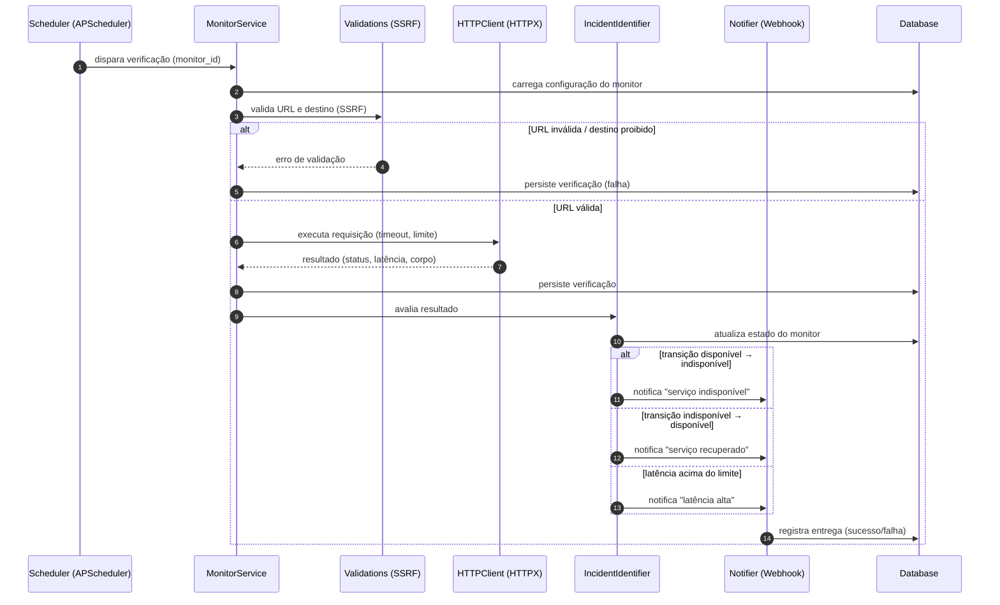

# BeaconOps

> **Observabilidade de APIs sem ruído. Saiba antes do seu usuário.**

BeaconOps é uma plataforma autogerenciada de monitoramento de disponibilidade e desempenho de APIs e serviços HTTP. Cadastre endpoints, defina critérios de sucesso, execute verificações periódicas e receba notificações quando algo sair do esperado — com histórico completo, identificação de incidentes e indicadores operacionais confiáveis.

---

## Sumário

- [Problema resolvido](#problema-resolvido)
- [Público-alvo](#público-alvo)
- [Funcionalidades](#funcionalidades)
- [Tecnologias](#tecnologias)
- [Arquitetura](#arquitetura)
- [Fluxo de monitoramento](#fluxo-de-monitoramento)
- [Estrutura de diretórios](#estrutura-de-diretórios)
- [Pré-requisitos](#pré-requisitos)
- [Instalação](#instalação)
- [Configuração](#configuração)
- [Variáveis de ambiente](#variáveis-de-ambiente)
- [Inicialização](#inicialização)
- [Endpoints da API](#endpoints-da-api)
- [Exemplos de utilização](#exemplos-de-utilização)
- [Testes](#testes)
- [Segurança](#segurança)
- [Limitações](#limitações)
- [Roadmap](#roadmap)
- [Licença](#licença)

---

## Problema resolvido

Equipes técnicas dependem de APIs internas e externas para manter suas aplicações funcionando. Falhas de disponibilidade, lentidão, códigos HTTP inesperados e respostas fora do contrato podem comprometer operações — e, sem monitoramento adequado, só são percebidas quando o usuário final já foi afetado.

O BeaconOps centraliza o monitoramento desses serviços em uma única aplicação, permitindo:

- Detectar APIs indisponíveis e endpoints com respostas HTTP inesperadas.
- Identificar aumento de latência e falhas consecutivas.
- Detectar alterações no comportamento esperado (validação de conteúdo).
- Registrar interrupções temporárias e recuperações.
- Notificar responsáveis por Webhook quando incidentes forem abertos ou encerrados.

O produto foi projetado para ser **autogerenciado**: você executa, controla e evolui a plataforma sem depender de serviços comerciais externos.

---

## Público-alvo

- Desenvolvedores backend e engenheiros de software.
- Administradores de sistemas e equipes de infraestrutura/operações.
- Pequenas empresas e equipes de tecnologia.
- Profissionais responsáveis por APIs e integrações.

---

## Funcionalidades

### Gerenciamento de monitores
- Cadastro, consulta, atualização, ativação/desativação e remoção de endpoints monitorados.
- Cada monitor possui: identificador, nome, URL, método HTTP, intervalo de verificação, timeout, status HTTP esperado, limite de latência, critério opcional de validação da resposta, estado de ativação e data de criação.
- Validação rigorosa de configurações — configurações inválidas são rejeitadas.

### Monitoramento automático
- Execução periódica dos monitores ativos via APScheduler.
- Verificações concorrentes com limite configurável (`BEACONOPS_MAX_CONCURRENT_CHECKS`).
- Tratamento de timeouts, falhas de conexão, erros HTTP e respostas inesperadas.
- Cancelamento seguro de operações e timeouts obrigatórios.

### Registro das verificações
- Cada execução gera um registro histórico com: monitor associado, data/hora, resultado, código HTTP, tempo de resposta, mensagem de erro (quando aplicável) e informações de diagnóstico.
- Diferenciação explícita entre verificações bem-sucedidas e malsucedidas.

### Identificação de incidentes
- Detecção de indisponibilidade por **falhas consecutivas** com limiar configurável (`BEACONOPS_FAILURE_THRESHOLD`).
- Transição de disponível → indisponível abre um incidente.
- Transição de indisponível → disponível encerra o incidente (recuperação), com limiar configurável (`BEACONOPS_RECOVERY_THRESHOLD`).
- Não abre um novo incidente para cada verificação malsucedida de um serviço já indisponível.

### Notificações
- Notificações por **Webhook HTTP** para eventos relevantes:
  - Serviço indisponível.
  - Serviço recuperado.
  - Latência acima do limite.
  - Alteração relevante no estado do monitor.
- Deduplicação de notificações e registro de falhas de entrega.
- Nenhuma credencial ou informação sensível é enviada desnecessariamente.

### Histórico e consulta
- Histórico de verificações com filtros e paginação.
- Estado atual dos monitores.
- Incidentes (ativos e encerrados).
- Tempo médio de resposta, taxa de disponibilidade, ocorrências de falhas e períodos de indisponibilidade.

### Indicadores operacionais
- **Uptime**: proporção de verificações bem-sucedidas no período de referência.
- **Downtime**: proporção de verificações malsucedidas no período.
- **Latência média** e **latência máxima** das verificações bem-sucedidas.
- **Quantidade de verificações** e **quantidade de falhas** no período.
- **Incidentes ativos** no momento da consulta.
- **Tempo de recuperação**: intervalo entre a abertura e o encerramento de cada incidente.

Todas as métricas são calculadas a partir de dados persistidos — nenhum valor é inventado ou estimado.

---

## Tecnologias

| Camada | Tecnologia | Responsabilidade |
|---|---|---|
| Backend | **FastAPI** | API REST, validação, OpenAPI automático. |
| Servidor | **Uvicorn** | Servidor ASGI de produção/desenvolvimento. |
| Validação | **Pydantic** | Contratos de entrada/saída e configuração. |
| HTTP | **HTTPX** | Requisições assíncronas com timeouts e limites. |
| Persistência | **SQLAlchemy** | ORM e abstração de banco (SQLite/PostgreSQL). |
| Agendamento | **APScheduler** | Execução periódica desacoplada da API. |
| Testes | **Pytest**, **pytest-cov** | Testes unitários/integração e cobertura. |
| Qualidade | **Ruff**, **MyPy** | Lint e verificação de tipos. |
| Infra | **Docker**, **Docker Compose** | Empacotamento e execução reproduzível. |
| CI | **GitHub Actions** | Execução automatizada de testes. |

Dependências deliberadamente **não** incluídas: Redis, Celery, Kafka e microsserviços — não há justificativa operacional concreta para o MVP.

---

## Arquitetura

O BeaconOps segue uma arquitetura modular com separação clara de responsabilidades:

- **API** (`api/`): rotas FastAPI, modelos Pydantic, tratamento de erros.
- **Domínio / Core** (`core/`): regras de negócio — monitores, agendamento, notificações.
- **Serviços** (`services/`): integrações e casos de uso — cliente HTTP, identificação de incidentes.
- **Utilitários** (`utils/`): validações (URL, resposta HTTP) e logging.
- **Configuração** (`config/`): settings centralizados via variáveis de ambiente.

O mecanismo de agendamento é desacoplado da lógica de negócio: as operações de monitoramento não dependem das rotas HTTP e podem ser executadas pelo scheduler, por testes ou por chamadas manuais.


---

## Fluxo de monitoramento



---

## Estrutura de diretórios

```
beaconops/
├── .github/
│   └── workflows/
│       └── tests.yml
├── src/
│   └── beaconops/
│       ├── __init__.py
│       ├── api/
│       │   ├── __init__.py
│       │   ├── routes.py
│       │   └── pydantic_models.py
│       ├── config/
│       │   └── settings.py
│       ├── core/
│       │   ├── __init__.py
│       │   ├── monitor.py
│       │   ├── schedule.py
│       │   └── notifications.py
│       ├── services/
│       │   ├── __init__.py
│       │   ├── http_client.py
│       │   └── incident_identification.py
│       └── utils/
│           ├── __init__.py
│           ├── validations.py
│           └── logging.py
├── tests/
│   ├── conftest.py
│   └── test_main.py
├── .env.example
├── .gitignore
├── CHANGELOG.md
├── Dockerfile
├── docker-compose.yml
├── LICENSE
├── pyproject.toml
├── README.md
└── requirements.txt
```

---

## Pré-requisitos

- **Python 3.11+** (testado em 3.11 e 3.12).
- **pip** atualizado.
- **Docker** e **Docker Compose** (opcional, para execução containerizada).
- Nenhum serviço externo é obrigatório para o MVP — SQLite é o padrão.

---

## Instalação

### Local (recomendado para desenvolvimento)

```bash
# 1. Clone o repositório
git clone https://github.com/<seu-usuario>/beaconops.git
cd beaconops

# 2. Crie e ative um ambiente virtual
python -m venv .venv
source .venv/bin/activate   # Linux/macOS
# .venv\Scripts\activate    # Windows

# 3. Instale as dependências
pip install --upgrade pip
pip install -r requirements.txt
pip install -e .

# 4. Configure o ambiente
cp .env.example .env
# Edite .env conforme necessário (veja a seção de variáveis)
```

### Docker

```bash
docker compose build
docker compose up -d
```

---

## Configuração

Toda a configuração é centralizada em `src/beaconops/config/settings.py` e lida a partir de variáveis de ambiente (com suporte a arquivo `.env`). Nenhum segredo é hardcoded.

Pontos de atenção:

- **`BEACONOPS_ADMIN_API_KEY`** deve ser gerada com um valor forte e aleatório:
  ```bash
  python -c "import secrets; print(secrets.token_urlsafe(32))"
  ```
- **`BEACONOPS_ALLOW_PRIVATE_TARGETS`** deve permanecer `false` em produção, salvo se você compreender plenamente o risco de SSRF.
- **`BEACONOPS_DATABASE_URL`** permite alternar entre SQLite (padrão) e PostgreSQL.

---

## Variáveis de ambiente

| Variável | Padrão | Descrição |
|---|---|---|
| `BEACONOPS_ENV` | `development` | Ambiente: `development`, `test`, `production`. |
| `BEACONOPS_LOG_LEVEL` | `INFO` | Nível de log (`DEBUG`, `INFO`, `WARNING`, `ERROR`, `CRITICAL`). |
| `BEACONOPS_DATABASE_URL` | `sqlite:///./beaconops.db` | URL SQLAlchemy do banco. |
| `BEACONOPS_HTTP_TIMEOUT_SECONDS` | `10` | Timeout padrão das requisições de monitoramento. |
| `BEACONOPS_HTTP_MAX_RESPONSE_BYTES` | `1048576` | Tamanho máximo do corpo lido. |
| `BEACONOPS_MAX_CONCURRENT_CHECKS` | `10` | Concorrência máxima de verificações. |
| `BEACONOPS_SCHEDULER_ENABLED` | `true` | Habilita o scheduler em background. |
| `BEACONOPS_DEFAULT_CHECK_INTERVAL_SECONDS` | `60` | Intervalo padrão entre verificações. |
| `BEACONOPS_FAILURE_THRESHOLD` | `3` | Falhas consecutivas para abrir incidente. |
| `BEACONOPS_RECOVERY_THRESHOLD` | `2` | Sucessos consecutivos para encerrar incidente. |
| `BEACONOPS_NOTIFICATIONS_ENABLED` | `true` | Habilita notificações por Webhook. |
| `BEACONOPS_DEFAULT_WEBHOOK_URL` | *(vazio)* | Webhook padrão quando o monitor não define um. |
| `BEACONOPS_WEBHOOK_TIMEOUT_SECONDS` | `5` | Timeout de entrega de Webhook. |
| `BEACONOPS_ALLOW_PRIVATE_TARGETS` | `false` | Permite alvos privados/loopback (risco de SSRF). |
| `BEACONOPS_ALLOWED_HOSTS` | *(vazio)* | Hostnames adicionais explicitamente permitidos. |
| `BEACONOPS_ALLOWED_PORTS` | `80,443` | Portas permitidas para endpoints monitorados. |
| `BEACONOPS_MAX_REDIRECTS` | `3` | Máximo de redirecionamentos seguidos. |
| `BEACONOPS_ADMIN_API_KEY` | *(vazio)* | Chave de API para endpoints administrativos. |
| `BEACONOPS_HOST` | `0.0.0.0` | Host do servidor Uvicorn. |
| `BEACONOPS_PORT` | `8000` | Porta do servidor Uvicorn. |
| `BEACONOPS_RELOAD` | `false` | Habilita auto-reload (apenas desenvolvimento). |

---

## Inicialização

### Local

```bash
# Aplicação (API + scheduler)
uvicorn beaconops.api.routes:app --host 0.0.0.0 --port 8000
```

A documentação OpenAPI estará disponível em:

- Swagger UI: `http://localhost:8000/docs`
- ReDoc: `http://localhost:8000/redoc`
- OpenAPI JSON: `http://localhost:8000/openapi.json`

### Docker Compose

```bash
docker compose up -d
docker compose logs -f beaconops
```

---

## Endpoints da API

> Todos os endpoints administrativos exigem o header `X-API-Key` com o valor de `BEACONOPS_ADMIN_API_KEY`.

### Saúde

| Método | Rota | Descrição |
|---|---|---|
| `GET` | `/health` | Verificação de saúde da aplicação. |

### Monitores

| Método | Rota | Descrição |
|---|---|---|
| `POST` | `/monitors` | Cria um monitor. |
| `GET` | `/monitors` | Lista monitores (filtros e paginação). |
| `GET` | `/monitors/{id}` | Consulta um monitor. |
| `PATCH` | `/monitors/{id}` | Atualiza um monitor. |
| `DELETE` | `/monitors/{id}` | Remove um monitor. |
| `POST` | `/monitors/{id}/check` | Executa verificação manual. |

### Verificações

| Método | Rota | Descrição |
|---|---|---|
| `GET` | `/monitors/{id}/checks` | Histórico de verificações (filtros e paginação). |

### Incidentes

| Método | Rota | Descrição |
|---|---|---|
| `GET` | `/incidents` | Lista incidentes (filtros e paginação). |
| `GET` | `/incidents/{id}` | Consulta um incidente. |

### Indicadores

| Método | Rota | Descrição |
|---|---|---|
| `GET` | `/monitors/{id}/metrics` | Indicadores operacionais do monitor. |

### Códigos de status

- `200 OK` — sucesso.
- `201 Created` — recurso criado.
- `204 No Content` — recurso removido.
- `400 Bad Request` — payload inválido.
- `401 Unauthorized` — chave de API ausente ou inválida.
- `404 Not Found` — recurso inexistente.
- `422 Unprocessable Entity` — falha de validação (Pydantic).
- `500 Internal Server Error` — erro inesperado.

---

## Exemplos de utilização

### Criar um monitor

```bash
curl -X POST http://localhost:8000/monitors \
  -H "Content-Type: application/json" \
  -H "X-API-Key: $BEACONOPS_ADMIN_API_KEY" \
  -d '{
    "name": "API pública de exemplo",
    "url": "https://api.exemplo.com/health",
    "method": "GET",
    "interval_seconds": 60,
    "timeout_seconds": 5,
    "expected_status": 200,
    "latency_threshold_ms": 800,
    "active": true
  }'
```

### Executar verificação manual

```bash
curl -X POST http://localhost:8000/monitors/1/check \
  -H "X-API-Key: $BEACONOPS_ADMIN_API_KEY"
```

### Consultar histórico de verificações

```bash
curl "http://localhost:8000/monitors/1/checks?limit=20&offset=0" \
  -H "X-API-Key: $BEACONOPS_ADMIN_API_KEY"
```

### Consultar indicadores

```bash
curl "http://localhost:8000/monitors/1/metrics?period=24h" \
  -H "X-API-Key: $BEACONOPS_ADMIN_API_KEY"
```

### Consultar incidentes ativos

```bash
curl "http://localhost:8000/incidents?status=open" \
  -H "X-API-Key: $BEACONOPS_ADMIN_API_KEY"
```

---

## Testes

```bash
# Executar toda a suíte
pytest -v

# Com cobertura
pytest --cov=beaconops --cov-report=term-missing

# Lint
ruff check src tests

# Verificação de tipos
mypy src
```

Os testes cobrem:

- Cadastro e validação de monitores.
- Validação de URLs e proteção contra SSRF.
- Respostas HTTP bem-sucedidas e inválidas.
- Timeouts e falhas de conexão.
- Execução periódica e falhas consecutivas.
- Criação e encerramento de incidentes.
- Deduplicação de notificações e falhas de Webhook.
- Persistência e consultas históricas.
- Cálculo de indicadores.

Os testes **não dependem de serviços externos ou credenciais reais** — utilizam mocks e servidores HTTP locais.

A CI (`.github/workflows/tests.yml`) executa lint, verificação de tipos e testes com cobertura em Python 3.11 e 3.12 a cada push e pull request.

---

## Segurança

O BeaconOps realiza requisições HTTP para endereços configurados pelos usuários. A proteção contra **Server-Side Request Forgery (SSRF)** é uma preocupação central:

- **Validação rigorosa de URLs**: apenas `http` e `https` são aceitos.
- **Bloqueio de destinos locais, privados, reservados e link-local** por padrão (`BEACONOPS_ALLOW_PRIVATE_TARGETS=false`).
- **Validação dos IPs resolvidos** — não apenas do texto da URL.
- **Proteção contra redirecionamentos** para destinos proibidos.
- **Restrição de portas** via `BEACONOPS_ALLOWED_PORTS`.
- **Timeouts obrigatórios** e **limite de tamanho de resposta**.
- **Proteção de credenciais**: nenhuma credencial é enviada em notificações.
- **Validação de Webhooks** com as mesmas regras de SSRF.
- **Controle de acesso** aos endpoints administrativos via `X-API-Key`.

### Limitações da estratégia de segurança

A validação textual de uma URL **não é suficiente** para impedir SSRF. O BeaconOps mitiga riscos considerando resolução DNS, redirecionamentos e destinos internos, mas **não oferece proteção absoluta**. Cenários como DNS rebinding, proxies intermediários maliciosos ou configurações administrativas permissivas podem contornar as defesas. Recomenda-se:

- Manter `BEACONOPS_ALLOW_PRIVATE_TARGETS=false` em produção.
- Restringir `BEACONOPS_ALLOWED_PORTS` ao mínimo necessário.
- Executar o serviço em rede isolada quando possível.
- Auditar periodicamente os monitores cadastrados.

---

## Limitações

- **Sem autenticação multiusuário** no MVP — apenas chave de API administrativa.
- **Sem painel frontend** — a interface é a API REST documentada.
- **SQLite** é o padrão; PostgreSQL é suportado via `BEACONOPS_DATABASE_URL`, mas o MVP foi validado primariamente em SQLite.
- **Notificações apenas por Webhook HTTP** — outros canais estão no roadmap.
- **Scheduler em processo único** — não há processamento distribuído no MVP.
- **Sem monitoramento de certificados TLS ou DNS** — previsto no roadmap.
- **Métricas calculadas a partir de dados persistidos** — não há estimativas ou projeções.

---

## Roadmap

### Prioridade alta
- Painel web com gráficos históricos.
- Autenticação e gerenciamento de usuários.
- Canais adicionais de notificação (e-mail, Slack, Telegram).
- Relatórios periódicos.

### Prioridade média
- Monitoramento de certificados TLS e DNS.
- Agrupamento de monitores.
- Políticas de escalonamento de incidentes.
- Métricas mais avançadas (percentis de latência, SLOs).

### Prioridade baixa
- Suporte ampliado e otimizado a PostgreSQL.
- Processamento distribuído (somente com justificativa operacional concreta).

> Funcionalidades listadas no roadmap **não estão implementadas** no MVP.

---

## Licença

Distribuído sob a licença **MIT**. Consulte o arquivo [LICENSE](LICENSE) para os termos completos.

---

**BeaconOps** — *Observabilidade de APIs sem ruído. Saiba antes do seu usuário.*