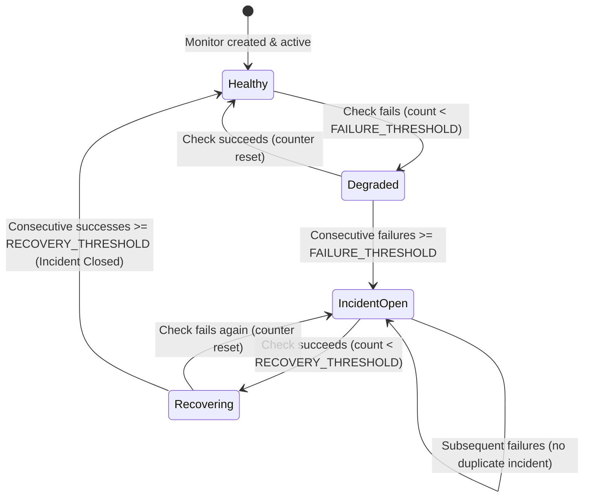
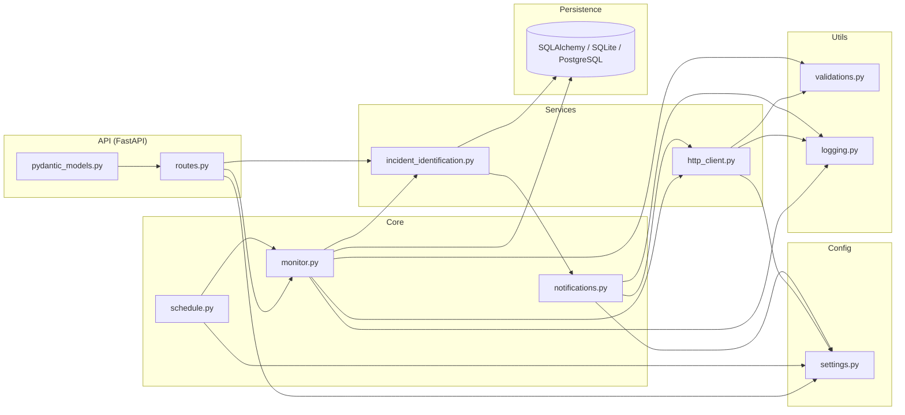
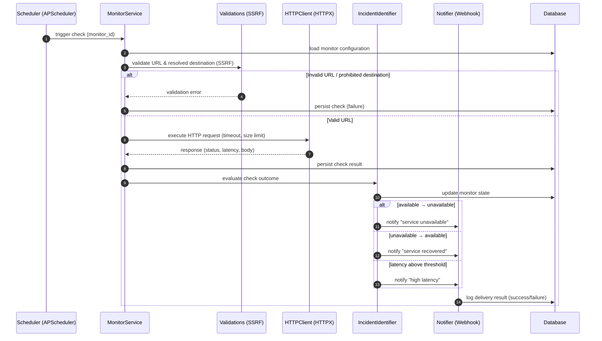
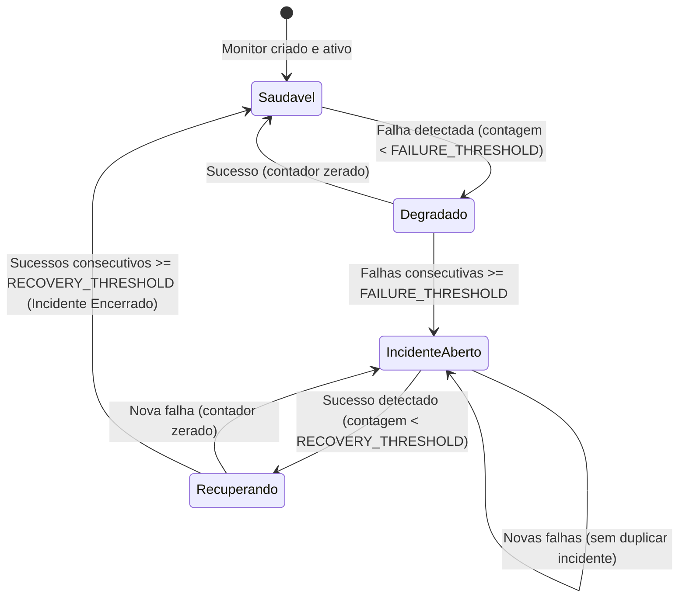
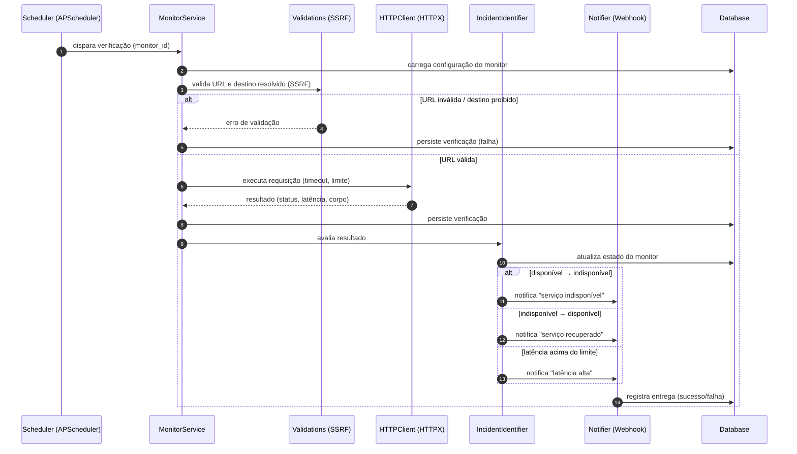

<a id="top"></a>

<div align="center">

# 🚦 BeaconOps

### API Monitoring & Observability Platform · Monitoramento & Observabilidade de APIs

<p>
  <a href="#english"><kbd>🇺🇸&nbsp; English Version</kbd></a>
  &nbsp;&nbsp;
  <a href="#portugues"><kbd>🇧🇷&nbsp; Versão em Português</kbd></a>
</p>

<a href="https://github.com/YohanVallier/BeaconOps">
  
</a>

<p>
  <code>Python 3.11+</code> · <code>FastAPI</code> · <code>HTTPX</code> · <code>APScheduler</code> · <code>SQLAlchemy</code> · <code>Docker</code> · <code>MIT License</code>
</p>

<p>
  
</p>

</div>

---

<a id="english"></a>

<div align="center">

## 🇺🇸 English Documentation

> **Noise-free API observability. Know before your users do.**

**BeaconOps** is a self-hosted platform for monitoring the availability and performance of APIs and HTTP services. Register endpoints, define success criteria, run scheduled asynchronous checks, and receive Webhook notifications when something goes wrong — with full history, automatic incident detection, and reliable operational metrics.

<p>
  <a href="#en-problem"><kbd>Problem</kbd></a>
  <a href="#en-features"><kbd>Features</kbd></a>
  <a href="#en-stack"><kbd>Stack</kbd></a>
  <a href="#en-architecture"><kbd>Architecture</kbd></a>
  <a href="#en-quickstart"><kbd>Quick Start</kbd></a>
  <a href="#en-api"><kbd>API</kbd></a>
  <a href="#en-security"><kbd>Security</kbd></a>
  <a href="#en-roadmap"><kbd>Roadmap</kbd></a>
</p>

</div>

---

<a id="en-problem"></a>

### 🎯 Problem Solved & Target Audience

Technical teams rely on internal and external APIs to keep their applications running. Availability failures, latency spikes, unexpected HTTP status codes, and contract-breaking responses can disrupt operations — and without proper monitoring, these issues are often only noticed after end users are already affected.

<table>
  <tr>
    <td width="55%" valign="top">
      <h4>🔍 What BeaconOps Solves</h4>
      <ul>
        <li>Detects unavailable APIs and unexpected HTTP status codes.</li>
        <li>Identifies latency spikes and consecutive failures early.</li>
        <li>Detects behavioral changes through optional response-content validation.</li>
        <li>Records temporary outages, recoveries, and full check history.</li>
        <li>Notifies owners via HTTP Webhooks when incidents open or close.</li>
      </ul>
      <p><em>Designed to be <strong>self-hosted</strong>: run, control, and evolve the platform without relying on external commercial tools.</em></p>
    </td>
    <td width="45%" valign="top">
      <h4>👥 Target Audience</h4>
      <ul>
        <li>Backend developers and software engineers.</li>
        <li>System administrators and DevOps / SRE teams.</li>
        <li>Small businesses and product engineering teams.</li>
        <li>Professionals maintaining critical APIs and integrations.</li>
      </ul>
    </td>
  </tr>
</table>

---

<a id="en-features"></a>

### ✨ Key Features

<table>
  <tr>
    <td width="50%" valign="top">
      <h4>📡 Monitor Management</h4>
      <ul>
        <li>Create, read, update, enable/disable, and delete monitored endpoints.</li>
        <li>Configurable ID, name, URL, HTTP method, interval, timeout, expected status, latency threshold, optional content validation, active flag, and timestamp.</li>
        <li>Strict configuration validation — invalid payloads are rejected immediately.</li>
      </ul>
    </td>
    <td width="50%" valign="top">
      <h4>⏱️ Automated Monitoring</h4>
      <ul>
        <li>Periodic execution of active monitors via <strong>APScheduler</strong>.</li>
        <li>Concurrent checks capped by <code>BEACONOPS_MAX_CONCURRENT_CHECKS</code>.</li>
        <li>Graceful handling of timeouts, connection failures, HTTP errors, and invalid responses.</li>
        <li>Safe operation cancellation and mandatory timeouts.</li>
      </ul>
    </td>
  </tr>
  <tr>
    <td width="50%" valign="top">
      <h4>🚨 Incident Detection</h4>
      <ul>
        <li>Detects outages via <strong>consecutive failures</strong> (<code>BEACONOPS_FAILURE_THRESHOLD</code>).</li>
        <li><code>available → unavailable</code> opens an incident automatically.</li>
        <li><code>unavailable → available</code> closes the incident via <code>BEACONOPS_RECOVERY_THRESHOLD</code>.</li>
        <li>Prevents alert storms by not creating duplicate incidents while a service remains down.</li>
      </ul>
    </td>
    <td width="50%" valign="top">
      <h4>🔔 Webhook Notifications</h4>
      <ul>
        <li>HTTP Webhooks for <strong>service down</strong>, <strong>service recovered</strong>, <strong>high latency</strong>, and relevant monitor state changes.</li>
        <li>Built-in notification deduplication and delivery failure logging.</li>
        <li>Zero unnecessary credentials or sensitive data leaked in webhook payloads.</li>
      </ul>
    </td>
  </tr>
  <tr>
    <td width="50%" valign="top">
      <h4>🗂️ Check Records & History</h4>
      <ul>
        <li>Persists every check with monitor ID, timestamp, outcome, HTTP status code, latency, error message, and diagnostics.</li>
        <li>Explicit distinction between successful and failed checks.</li>
        <li>Filterable and paginated queries for checks, monitor states, and open/closed incidents.</li>
      </ul>
    </td>
    <td width="50%" valign="top">
      <h4>📊 Operational Metrics</h4>
      <ul>
        <li><strong>Uptime & Downtime:</strong> exact ratios over the queried period.</li>
        <li><strong>Average & Max Latency</strong> for successful checks.</li>
        <li><strong>Total Checks, Failures & Active Incidents.</strong></li>
        <li><strong>Recovery Time:</strong> duration between incident opening and resolution.</li>
      </ul>
    </td>
  </tr>
</table>

> [!NOTE]
> All operational metrics are computed strictly from persisted historical data — no values are fabricated or estimated.

#### 🔄 Incident Lifecycle



---

<a id="en-stack"></a>

### 🧰 Technology Stack

| Layer | Technology | Responsibility |
|---|---|---|
| **Backend** | `FastAPI` | REST API, validation, and automatic OpenAPI docs. |
| **Server** | `Uvicorn` | ASGI server for development and production. |
| **Validation** | `Pydantic` | Input/output contracts and settings management. |
| **HTTP Client** | `HTTPX` | Asynchronous HTTP requests with strict timeouts and size limits. |
| **Persistence** | `SQLAlchemy` | ORM and database abstraction (`SQLite` default / `PostgreSQL` supported). |
| **Scheduling** | `APScheduler` | Periodic check execution decoupled from HTTP routes. |
| **Testing** | `Pytest` · `pytest-cov` | Unit/integration test suite and code coverage. |
| **Code Quality** | `Ruff` · `MyPy` | Linting and static type checking. |
| **Infrastructure** | `Docker` · `Docker Compose` | Reproducible container packaging and execution. |
| **CI** | `GitHub Actions` | Automated linting, type checking, and tests on Python 3.11 & 3.12. |

> [!TIP]
> **Deliberately excluded dependencies:** Redis, Celery, Kafka, and microservices — there is no concrete operational justification for adding that complexity to the MVP.

---

<a id="en-architecture"></a>

### 🏗️ Architecture & Monitoring Workflow

BeaconOps follows a clean modular architecture with decoupled scheduling — monitoring operations do not depend on HTTP routes and can be triggered by the background scheduler, tests, or manual API calls:

- **`api/`**: FastAPI routes, Pydantic models, and error handling.
- **`core/`**: domain business logic — monitors, scheduling, and notifications.
- **`services/`**: integrations and use cases — async HTTP client and incident identification.
- **`utils/`**: security validations (URL, SSRF, HTTP responses) and structured logging.
- **`config/`**: centralized environment-based settings.



#### ⚡ Check Execution Sequence



<details>
<summary><strong>📁 Directory Structure (Click to expand)</strong></summary>

```text
beaconops/
├── .github/
│   └── workflows/
│       └── tests.yml
├── src/
│   └── beaconops/
│       ├── __init__.py
│       ├── api/
│       │   ├── __init__.py
│       │   ├── routes.py
│       │   └── pydantic_models.py
│       ├── config/
│       │   └── settings.py
│       ├── core/
│       │   ├── __init__.py
│       │   ├── monitor.py
│       │   ├── schedule.py
│       │   └── notifications.py
│       ├── services/
│       │   ├── __init__.py
│       │   ├── http_client.py
│       │   └── incident_identification.py
│       └── utils/
│           ├── __init__.py
│           ├── validations.py
│           └── logging.py
├── tests/
│   ├── conftest.py
│   └── test_main.py
├── .env.example
├── .gitignore
├── CHANGELOG.md
├── Dockerfile
├── docker-compose.yml
├── LICENSE
├── pyproject.toml
├── README.md
└── requirements.txt
```

</details>

---

<a id="en-quickstart"></a>

### 🚀 Prerequisites, Installation & Configuration

**Prerequisites:** Python **3.11+** (tested on 3.11 & 3.12), updated `pip`, and optional **Docker / Docker Compose**. No external database is required for the MVP (`SQLite` is the default).

<table>
  <tr>
    <td width="55%" valign="top">
      <h4>💻 Local Setup (Development)</h4>

```bash
# 1. Clone the repository
git clone https://github.com/YohanVallier/BeaconOps.git
cd BeaconOps

# 2. Create and activate a virtual environment
python -m venv .venv
source .venv/bin/activate   # Linux/macOS
# .venv\Scripts\activate    # Windows

# 3. Install dependencies
pip install --upgrade pip
pip install -r requirements.txt
pip install -e .

# 4. Configure environment variables
cp .env.example .env

# 5. Start the application (API + Scheduler)
uvicorn beaconops.api.routes:app --host 0.0.0.0 --port 8000
```

    </td>
    <td width="45%" valign="top">
      <h4>🐳 Docker Compose</h4>

```bash
# Build and start containers
docker compose build
docker compose up -d

# Follow logs
docker compose logs -f beaconops
```

      <h4>📖 Interactive OpenAPI Docs</h4>
      <ul>
        <li><strong>Swagger UI:</strong> <code>http://localhost:8000/docs</code></li>
        <li><strong>ReDoc:</strong> <code>http://localhost:8000/redoc</code></li>
        <li><strong>OpenAPI JSON:</strong> <code>http://localhost:8000/openapi.json</code></li>
      </ul>
    </td>
  </tr>
</table>

#### ⚙️ Key Configuration Notes

All settings are centralized in `src/beaconops/config/settings.py` and read from environment variables (`.env` supported). No secrets are hardcoded.

- Generate a strong random **`BEACONOPS_ADMIN_API_KEY`**:
  ```bash
  python -c "import secrets; print(secrets.token_urlsafe(32))"
  ```
- Keep **`BEACONOPS_ALLOW_PRIVATE_TARGETS=false`** in production unless you fully understand SSRF implications.
- Use **`BEACONOPS_DATABASE_URL`** to switch between SQLite (default) and PostgreSQL.

<details>
<summary><strong>🔧 Full Environment Variables Reference (21 variables — Click to expand)</strong></summary>

| Variable | Default | Description |
|---|---|---|
| `BEACONOPS_ENV` | `development` | Environment: `development`, `test`, `production`. |
| `BEACONOPS_LOG_LEVEL` | `INFO` | Log level (`DEBUG`, `INFO`, `WARNING`, `ERROR`, `CRITICAL`). |
| `BEACONOPS_DATABASE_URL` | `sqlite:///./beaconops.db` | SQLAlchemy database URL. |
| `BEACONOPS_HTTP_TIMEOUT_SECONDS` | `10` | Default timeout for monitoring requests. |
| `BEACONOPS_HTTP_MAX_RESPONSE_BYTES` | `1048576` | Maximum response body size to read (1 MB). |
| `BEACONOPS_MAX_CONCURRENT_CHECKS` | `10` | Maximum concurrent checks. |
| `BEACONOPS_SCHEDULER_ENABLED` | `true` | Enables the background scheduler. |
| `BEACONOPS_DEFAULT_CHECK_INTERVAL_SECONDS` | `60` | Default interval between checks. |
| `BEACONOPS_FAILURE_THRESHOLD` | `3` | Consecutive failures required to open an incident. |
| `BEACONOPS_RECOVERY_THRESHOLD` | `2` | Consecutive successes required to close an incident. |
| `BEACONOPS_NOTIFICATIONS_ENABLED` | `true` | Enables Webhook notifications. |
| `BEACONOPS_DEFAULT_WEBHOOK_URL` | *(empty)* | Default Webhook URL when none is configured per monitor. |
| `BEACONOPS_WEBHOOK_TIMEOUT_SECONDS` | `5` | Webhook delivery timeout. |
| `BEACONOPS_ALLOW_PRIVATE_TARGETS` | `false` | Allows private/loopback targets (SSRF risk). |
| `BEACONOPS_ALLOWED_HOSTS` | *(empty)* | Additional explicitly allowed hostnames. |
| `BEACONOPS_ALLOWED_PORTS` | `80,443` | Allowed ports for monitored endpoints. |
| `BEACONOPS_MAX_REDIRECTS` | `3` | Maximum number of consecutive redirects followed. |
| `BEACONOPS_ADMIN_API_KEY` | *(empty)* | API key for administrative endpoints. |
| `BEACONOPS_HOST` | `0.0.0.0` | Uvicorn server host. |
| `BEACONOPS_PORT` | `8000` | Uvicorn server port. |
| `BEACONOPS_RELOAD` | `false` | Enables auto-reload (development only). |

</details>

---

<a id="en-api"></a>

### 🔌 API Endpoints & Usage Examples

> [!IMPORTANT]
> All administrative endpoints require the `X-API-Key` header matching `BEACONOPS_ADMIN_API_KEY`.

| Category | Method | Route | Description |
|---|---|---|---|
| **Health** | `GET` | `/health` | Application health check. |
| **Monitors** | `POST` | `/monitors` | Creates a new monitor. |
| **Monitors** | `GET` | `/monitors` | Lists monitors (with filtering and pagination). |
| **Monitors** | `GET` | `/monitors/{id}` | Retrieves a specific monitor. |
| **Monitors** | `PATCH` | `/monitors/{id}` | Updates a monitor. |
| **Monitors** | `DELETE` | `/monitors/{id}` | Deletes a monitor. |
| **Monitors** | `POST` | `/monitors/{id}/check` | Triggers an immediate manual check. |
| **Checks** | `GET` | `/monitors/{id}/checks` | Check history (with filtering and pagination). |
| **Incidents** | `GET` | `/incidents` | Lists incidents (with filtering and pagination). |
| **Incidents** | `GET` | `/incidents/{id}` | Retrieves a specific incident. |
| **Metrics** | `GET` | `/monitors/{id}/metrics` | Operational metrics for a monitor. |

**HTTP Status Codes:** `200 OK` · `201 Created` · `204 No Content` · `400 Bad Request` · `401 Unauthorized` · `404 Not Found` · `422 Unprocessable Entity` · `500 Internal Server Error`

<details>
<summary><strong>💻 cURL Usage Examples (Click to expand)</strong></summary>

**Create a Monitor**
```bash
curl -X POST http://localhost:8000/monitors \
  -H "Content-Type: application/json" \
  -H "X-API-Key: $BEACONOPS_ADMIN_API_KEY" \
  -d '{
    "name": "Example public API",
    "url": "https://api.example.com/health",
    "method": "GET",
    "interval_seconds": 60,
    "timeout_seconds": 5,
    "expected_status": 200,
    "latency_threshold_ms": 800,
    "active": true
  }'
```

**Run a Manual Check**
```bash
curl -X POST http://localhost:8000/monitors/1/check \
  -H "X-API-Key: $BEACONOPS_ADMIN_API_KEY"
```

**Retrieve Check History**
```bash
curl "http://localhost:8000/monitors/1/checks?limit=20&offset=0" \
  -H "X-API-Key: $BEACONOPS_ADMIN_API_KEY"
```

**Retrieve Operational Metrics**
```bash
curl "http://localhost:8000/monitors/1/metrics?period=24h" \
  -H "X-API-Key: $BEACONOPS_ADMIN_API_KEY"
```

**Retrieve Active Incidents**
```bash
curl "http://localhost:8000/incidents?status=open" \
  -H "X-API-Key: $BEACONOPS_ADMIN_API_KEY"
```

</details>

---

### 🧪 Testing & Quality Assurance

```bash
pytest -v                                        # Run full test suite
pytest --cov=beaconops --cov-report=term-missing # Coverage report
ruff check src tests                             # Linting
mypy src                                         # Static type checking
```

- **Test Coverage:** monitor CRUD & validation, URL & SSRF protection, valid/invalid HTTP responses, timeouts & connection errors, periodic execution & consecutive failures, incident opening/closing, webhook deduplication & failures, historical persistence, and metric calculations.
- **Zero External Dependencies:** all tests rely on mocks and local HTTP servers (no live credentials required).
- **Automated CI:** `.github/workflows/tests.yml` runs linting, type checking, and coverage tests on **Python 3.11 & 3.12** on every push and pull request.

---

<a id="en-security"></a>

### 🛡️ Security & Limitations

<table>
  <tr>
    <td width="50%" valign="top">
      <h4>🔒 SSRF & API Security Controls</h4>
      <ul>
        <li>Strict URL scheme validation (<code>http</code> / <code>https</code> only).</li>
        <li>Blocks local, private, reserved, and link-local destinations by default.</li>
        <li>Validates <strong>resolved IP addresses</strong> — not just URL text.</li>
        <li>Blocks redirects pointing to prohibited internal targets.</li>
        <li>Port restrictions via <code>BEACONOPS_ALLOWED_PORTS</code>.</li>
        <li>Mandatory request timeouts and response-size caps.</li>
        <li>Webhook URLs validated under the exact same SSRF rules.</li>
        <li>Admin endpoint protection via <code>X-API-Key</code> + zero leaked secrets.</li>
      </ul>
    </td>
    <td width="50%" valign="top">
      <h4>⚠️ Current MVP Limitations</h4>
      <ul>
        <li>Single administrative API key (no multi-user auth yet).</li>
        <li>No frontend dashboard — exposed as a documented REST API.</li>
        <li>SQLite default (PostgreSQL supported, MVP primarily validated on SQLite).</li>
        <li>HTTP Webhook notifications only (other channels on roadmap).</li>
        <li>Single-process scheduler (no distributed workers in MVP).</li>
        <li>No TLS certificate or DNS monitoring yet.</li>
        <li>Metrics strictly reflect persisted data (no forecasts/estimates).</li>
      </ul>
    </td>
  </tr>
</table>

> [!WARNING]
> **Security Strategy Caveat:** Text-based URL checks alone cannot prevent SSRF. BeaconOps mitigates risk via DNS resolution checks, redirect inspection, and private-range blocking, but **cannot guarantee absolute protection** against DNS rebinding, malicious proxies, or overly permissive configs. Always keep `BEACONOPS_ALLOW_PRIVATE_TARGETS=false`, restrict `BEACONOPS_ALLOWED_PORTS`, run in an isolated network when possible, and periodically audit registered monitors.

---

<a id="en-roadmap"></a>

### 🗺️ Roadmap

<table>
  <tr>
    <td width="33%" valign="top">
      <h4>🔴 High Priority</h4>
      <ul>
        <li>Web dashboard with historical charts.</li>
        <li>User authentication & management.</li>
        <li>Extra notification channels (email, Slack, Telegram).</li>
        <li>Scheduled operational reports.</li>
      </ul>
    </td>
    <td width="33%" valign="top">
      <h4>🟡 Medium Priority</h4>
      <ul>
        <li>TLS certificate & DNS monitoring.</li>
        <li>Monitor grouping & tags.</li>
        <li>Incident escalation policies.</li>
        <li>Advanced metrics (latency percentiles, SLOs).</li>
      </ul>
    </td>
    <td width="33%" valign="top">
      <h4>🟢 Low Priority</h4>
      <ul>
        <li>Expanded & optimized PostgreSQL support.</li>
        <li>Distributed execution (only when operationally justified).</li>
      </ul>
    </td>
  </tr>
</table>

> [!NOTE]
> Roadmap items are planned future evolutions and are **not implemented** in the current MVP.

### 📄 License

Distributed under the **MIT License**. See [`LICENSE`](LICENSE) for full terms.

<div align="center">

**BeaconOps** — *Noise-free API observability. Know before your users do.*

[⬆️ Back to top](#top) · [🇧🇷 Ir para a versão em Português](#portugues)

</div>

---

<a id="portugues"></a>

<div align="center">

## 🇧🇷 Documentação em Português

> **Observabilidade de APIs sem ruído. Saiba antes do seu usuário.**

O **BeaconOps** é uma plataforma autogerenciada de monitoramento de disponibilidade e desempenho de APIs e serviços HTTP. Cadastre endpoints, defina critérios de sucesso, execute verificações assíncronas periódicas e receba notificações via Webhook quando algo sair do esperado — com histórico completo, identificação automática de incidentes e indicadores operacionais confiáveis.

<p>
  <a href="#pt-problema"><kbd>Problema</kbd></a>
  <a href="#pt-funcionalidades"><kbd>Funcionalidades</kbd></a>
  <a href="#pt-tecnologias"><kbd>Tecnologias</kbd></a>
  <a href="#pt-arquitetura"><kbd>Arquitetura</kbd></a>
  <a href="#pt-instalacao"><kbd>Instalação</kbd></a>
  <a href="#pt-api"><kbd>API</kbd></a>
  <a href="#pt-seguranca"><kbd>Segurança</kbd></a>
  <a href="#pt-roadmap"><kbd>Roadmap</kbd></a>
</p>

</div>

---

<a id="pt-problema"></a>

### 🎯 Problema Resolvido & Público-Alvo

Equipes técnicas dependem de APIs internas e externas para manter suas aplicações funcionando. Falhas de disponibilidade, lentidão, códigos HTTP inesperados e respostas fora do contrato podem comprometer operações — e, sem monitoramento adequado, só são percebidas quando o usuário final já foi afetado.

<table>
  <tr>
    <td width="55%" valign="top">
      <h4>🔍 O que o BeaconOps Resolve</h4>
      <ul>
        <li>Detecta APIs indisponíveis e endpoints com status HTTP inesperados.</li>
        <li>Identifica aumento de latência e falhas consecutivas antecipadamente.</li>
        <li>Detecta alterações no comportamento esperado (validação opcional de conteúdo).</li>
        <li>Registra interrupções temporárias, recuperações e histórico completo.</li>
        <li>Notifica responsáveis via Webhook HTTP na abertura ou encerramento de incidentes.</li>
      </ul>
      <p><em>Projetado para ser <strong>autogerenciado</strong>: você executa, controla e evolui a plataforma sem depender de serviços comerciais externos.</em></p>
    </td>
    <td width="45%" valign="top">
      <h4>👥 Público-Alvo</h4>
      <ul>
        <li>Desenvolvedores backend e engenheiros de software.</li>
        <li>Administradores de sistemas e equipes de infraestrutura / operações.</li>
        <li>Pequenas empresas e times de tecnologia.</li>
        <li>Profissionais responsáveis por APIs e integrações críticas.</li>
      </ul>
    </td>
  </tr>
</table>

---

<a id="pt-funcionalidades"></a>

### ✨ Funcionalidades

<table>
  <tr>
    <td width="50%" valign="top">
      <h4>📡 Gerenciamento de Monitores</h4>
      <ul>
        <li>Cadastro, consulta, atualização, ativação/desativação e remoção de endpoints.</li>
        <li>Configuração de ID, nome, URL, método HTTP, intervalo, timeout, status esperado, limite de latência, validação opcional de conteúdo, estado e data de criação.</li>
        <li>Validação rigorosa — configurações inválidas são rejeitadas de imediato.</li>
      </ul>
    </td>
    <td width="50%" valign="top">
      <h4>⏱️ Monitoramento Automático</h4>
      <ul>
        <li>Execução periódica dos monitores ativos via <strong>APScheduler</strong>.</li>
        <li>Verificações concorrentes com limite em <code>BEACONOPS_MAX_CONCURRENT_CHECKS</code>.</li>
        <li>Tratamento de timeouts, falhas de conexão, erros HTTP e respostas inválidas.</li>
        <li>Cancelamento seguro de operações e timeouts obrigatórios.</li>
      </ul>
    </td>
  </tr>
  <tr>
    <td width="50%" valign="top">
      <h4>🚨 Identificação de Incidentes</h4>
      <ul>
        <li>Detecção de queda por <strong>falhas consecutivas</strong> (<code>BEACONOPS_FAILURE_THRESHOLD</code>).</li>
        <li><code>disponível → indisponível</code> abre um incidente automaticamente.</li>
        <li><code>indisponível → disponível</code> encerra o incidente via <code>BEACONOPS_RECOVERY_THRESHOLD</code>.</li>
        <li>Evita duplicação de incidentes enquanto o serviço já estiver indisponível.</li>
      </ul>
    </td>
    <td width="50%" valign="top">
      <h4>🔔 Notificações por Webhook</h4>
      <ul>
        <li>Webhooks HTTP para <strong>serviço indisponível</strong>, <strong>serviço recuperado</strong>, <strong>latência alta</strong> e mudanças relevantes de estado.</li>
        <li>Deduplicação de alertas e registro de falhas de entrega.</li>
        <li>Nenhuma credencial ou dado sensível é exposto desnecessariamente.</li>
      </ul>
    </td>
  </tr>
  <tr>
    <td width="50%" valign="top">
      <h4>🗂️ Histórico e Consultas</h4>
      <ul>
        <li>Cada verificação registra monitor, data/hora, resultado, código HTTP, tempo de resposta, erro e diagnóstico.</li>
        <li>Distinção explícita entre verificações bem-sucedidas e malsucedidas.</li>
        <li>Consultas com filtros e paginação para histórico, monitores e incidentes.</li>
      </ul>
    </td>
    <td width="50%" valign="top">
      <h4>📊 Indicadores Operacionais</h4>
      <ul>
        <li><strong>Uptime e Downtime:</strong> proporções reais no período consultado.</li>
        <li><strong>Latência Média e Máxima</strong> das verificações bem-sucedidas.</li>
        <li><strong>Total de Verificações, Falhas e Incidentes Ativos.</strong></li>
        <li><strong>Tempo de Recuperação:</strong> intervalo entre abertura e encerramento de cada incidente.</li>
      </ul>
    </td>
  </tr>
</table>

> [!NOTE]
> Todas as métricas são calculadas estritamente a partir de dados persistidos — nenhum valor é inventado ou estimado.

#### 🔄 Ciclo de Vida de um Incidente



---

<a id="pt-tecnologias"></a>

### 🧰 Tecnologias

| Camada | Tecnologia | Responsabilidade |
|---|---|---|
| **Backend** | `FastAPI` | API REST, validação e documentação OpenAPI automática. |
| **Servidor** | `Uvicorn` | Servidor ASGI de desenvolvimento e produção. |
| **Validação** | `Pydantic` | Contratos de entrada/saída e configuração. |
| **Cliente HTTP** | `HTTPX` | Requisições assíncronas com timeouts e limites de corpo. |
| **Persistência** | `SQLAlchemy` | ORM e abstração de banco (`SQLite` padrão / suporte a `PostgreSQL`). |
| **Agendamento** | `APScheduler` | Execução periódica desacoplada das rotas HTTP. |
| **Testes** | `Pytest` · `pytest-cov` | Testes unitários/integração e cobertura de código. |
| **Qualidade** | `Ruff` · `MyPy` | Lint e verificação estática de tipos. |
| **Infraestrutura** | `Docker` · `Docker Compose` | Empacotamento e execução reproduzível. |
| **CI** | `GitHub Actions` | Lint, checagem de tipos e testes automatizados em Python 3.11 e 3.12. |

> [!TIP]
> **Dependências deliberadamente não incluídas:** Redis, Celery, Kafka e microsserviços — não há justificativa operacional concreta para adicionar essa complexidade ao MVP.

---

<a id="pt-arquitetura"></a>

### 🏗️ Arquitetura & Fluxo de Monitoramento

O BeaconOps segue uma arquitetura modular com agendamento desacoplado da lógica de negócio — as verificações não dependem das rotas HTTP e podem ser executadas pelo scheduler, por testes ou por chamadas manuais:

- **`api/`**: rotas FastAPI, modelos Pydantic e tratamento de erros.
- **`core/`**: regras de domínio — monitores, agendamento e notificações.
- **`services/`**: integrações e casos de uso — cliente HTTP assíncrono e identificação de incidentes.
- **`utils/`**: validações de segurança (URL, SSRF, respostas HTTP) e logging estruturado.
- **`config/`**: configurações centralizadas via variáveis de ambiente.


#### ⚡ Sequência de Execução de uma Verificação



<details>
<summary><strong>📁 Estrutura de Diretórios (Clique para expandir)</strong></summary>

```text
beaconops/
├── .github/
│   └── workflows/
│       └── tests.yml
├── src/
│   └── beaconops/
│       ├── __init__.py
│       ├── api/
│       │   ├── __init__.py
│       │   ├── routes.py
│       │   └── pydantic_models.py
│       ├── config/
│       │   └── settings.py
│       ├── core/
│       │   ├── __init__.py
│       │   ├── monitor.py
│       │   ├── schedule.py
│       │   └── notifications.py
│       ├── services/
│       │   ├── __init__.py
│       │   ├── http_client.py
│       │   └── incident_identification.py
│       └── utils/
│           ├── __init__.py
│           ├── validations.py
│           └── logging.py
├── tests/
│   ├── conftest.py
│   └── test_main.py
├── .env.example
├── .gitignore
├── CHANGELOG.md
├── Dockerfile
├── docker-compose.yml
├── LICENSE
├── pyproject.toml
├── README.md
└── requirements.txt
```

</details>

---

<a id="pt-instalacao"></a>

### 🚀 Pré-requisitos, Instalação & Configuração

**Pré-requisitos:** Python **3.11+** (testado em 3.11 e 3.12), `pip` atualizado e **Docker / Docker Compose** (opcional). Nenhum banco externo é obrigatório no MVP (`SQLite` é o padrão).

<table>
  <tr>
    <td width="55%" valign="top">
      <h4>💻 Execução Local (Desenvolvimento)</h4>

```bash
# 1. Clone o repositório
git clone https://github.com/YohanVallier/BeaconOps.git
cd BeaconOps

# 2. Crie e ative um ambiente virtual
python -m venv .venv
source .venv/bin/activate   # Linux/macOS
# .venv\Scripts\activate    # Windows

# 3. Instale as dependências
pip install --upgrade pip
pip install -r requirements.txt
pip install -e .

# 4. Configure as variáveis de ambiente
cp .env.example .env

# 5. Inicie a aplicação (API + Scheduler)
uvicorn beaconops.api.routes:app --host 0.0.0.0 --port 8000
```

    </td>
    <td width="45%" valign="top">
      <h4>🐳 Docker Compose</h4>

```bash
# Construa e suba os containers
docker compose build
docker compose up -d

# Acompanhe os logs
docker compose logs -f beaconops
```

      <h4>📖 Documentação OpenAPI Interativa</h4>
      <ul>
        <li><strong>Swagger UI:</strong> <code>http://localhost:8000/docs</code></li>
        <li><strong>ReDoc:</strong> <code>http://localhost:8000/redoc</code></li>
        <li><strong>OpenAPI JSON:</strong> <code>http://localhost:8000/openapi.json</code></li>
      </ul>
    </td>
  </tr>
</table>

#### ⚙️ Pontos de Atenção na Configuração

Toda a configuração fica centralizada em `src/beaconops/config/settings.py` e é lida via variáveis de ambiente (com suporte a `.env`). Nenhum segredo é hardcoded.

- Gere uma chave forte e aleatória para **`BEACONOPS_ADMIN_API_KEY`**:
  ```bash
  python -c "import secrets; print(secrets.token_urlsafe(32))"
  ```
- Mantenha **`BEACONOPS_ALLOW_PRIVATE_TARGETS=false`** em produção, salvo se compreender plenamente os riscos de SSRF.
- Use **`BEACONOPS_DATABASE_URL`** para alternar entre SQLite (padrão) e PostgreSQL.

<details>
<summary><strong>🔧 Referência Completa de Variáveis de Ambiente (21 variáveis — Clique para expandir)</strong></summary>

| Variável | Padrão | Descrição |
|---|---|---|
| `BEACONOPS_ENV` | `development` | Ambiente: `development`, `test`, `production`. |
| `BEACONOPS_LOG_LEVEL` | `INFO` | Nível de log (`DEBUG`, `INFO`, `WARNING`, `ERROR`, `CRITICAL`). |
| `BEACONOPS_DATABASE_URL` | `sqlite:///./beaconops.db` | URL SQLAlchemy do banco de dados. |
| `BEACONOPS_HTTP_TIMEOUT_SECONDS` | `10` | Timeout padrão das requisições de monitoramento. |
| `BEACONOPS_HTTP_MAX_RESPONSE_BYTES` | `1048576` | Tamanho máximo do corpo lido (1 MB). |
| `BEACONOPS_MAX_CONCURRENT_CHECKS` | `10` | Concorrência máxima de verificações. |
| `BEACONOPS_SCHEDULER_ENABLED` | `true` | Habilita o scheduler em background. |
| `BEACONOPS_DEFAULT_CHECK_INTERVAL_SECONDS` | `60` | Intervalo padrão entre verificações. |
| `BEACONOPS_FAILURE_THRESHOLD` | `3` | Falhas consecutivas para abrir um incidente. |
| `BEACONOPS_RECOVERY_THRESHOLD` | `2` | Sucessos consecutivos para encerrar um incidente. |
| `BEACONOPS_NOTIFICATIONS_ENABLED` | `true` | Habilita notificações por Webhook. |
| `BEACONOPS_DEFAULT_WEBHOOK_URL` | *(vazio)* | Webhook padrão quando o monitor não define um. |
| `BEACONOPS_WEBHOOK_TIMEOUT_SECONDS` | `5` | Timeout de entrega de Webhook. |
| `BEACONOPS_ALLOW_PRIVATE_TARGETS` | `false` | Permite alvos privados/loopback (risco de SSRF). |
| `BEACONOPS_ALLOWED_HOSTS` | *(vazio)* | Hostnames adicionais explicitamente permitidos. |
| `BEACONOPS_ALLOWED_PORTS` | `80,443` | Portas permitidas para endpoints monitorados. |
| `BEACONOPS_MAX_REDIRECTS` | `3` | Máximo de redirecionamentos consecutivos seguidos. |
| `BEACONOPS_ADMIN_API_KEY` | *(vazio)* | Chave de API para endpoints administrativos. |
| `BEACONOPS_HOST` | `0.0.0.0` | Host do servidor Uvicorn. |
| `BEACONOPS_PORT` | `8000` | Porta do servidor Uvicorn. |
| `BEACONOPS_RELOAD` | `false` | Habilita auto-reload (apenas desenvolvimento). |

</details>

---

<a id="pt-api"></a>

### 🔌 Endpoints da API & Exemplos de Uso

> [!IMPORTANT]
> Todos os endpoints administrativos exigem o header `X-API-Key` com o valor configurado em `BEACONOPS_ADMIN_API_KEY`.

| Categoria | Método | Rota | Descrição |
|---|---|---|---|
| **Saúde** | `GET` | `/health` | Verificação de saúde da aplicação. |
| **Monitores** | `POST` | `/monitors` | Cria um novo monitor. |
| **Monitores** | `GET` | `/monitors` | Lista monitores (filtros e paginação). |
| **Monitores** | `GET` | `/monitors/{id}` | Consulta um monitor específico. |
| **Monitores** | `PATCH` | `/monitors/{id}` | Atualiza um monitor. |
| **Monitores** | `DELETE` | `/monitors/{id}` | Remove um monitor. |
| **Monitores** | `POST` | `/monitors/{id}/check` | Executa uma verificação manual imediata. |
| **Verificações** | `GET` | `/monitors/{id}/checks` | Histórico de verificações (filtros e paginação). |
| **Incidentes** | `GET` | `/incidents` | Lista incidentes (filtros e paginação). |
| **Incidentes** | `GET` | `/incidents/{id}` | Consulta um incidente específico. |
| **Indicadores** | `GET` | `/monitors/{id}/metrics` | Indicadores operacionais do monitor. |

**Códigos de Status HTTP:** `200 OK` · `201 Created` · `204 No Content` · `400 Bad Request` · `401 Unauthorized` · `404 Not Found` · `422 Unprocessable Entity` · `500 Internal Server Error`

<details>
<summary><strong>💻 Exemplos de Uso com cURL (Clique para expandir)</strong></summary>

**Criar um monitor**
```bash
curl -X POST http://localhost:8000/monitors \
  -H "Content-Type: application/json" \
  -H "X-API-Key: $BEACONOPS_ADMIN_API_KEY" \
  -d '{
    "name": "API pública de exemplo",
    "url": "https://api.exemplo.com/health",
    "method": "GET",
    "interval_seconds": 60,
    "timeout_seconds": 5,
    "expected_status": 200,
    "latency_threshold_ms": 800,
    "active": true
  }'
```

**Executar verificação manual**
```bash
curl -X POST http://localhost:8000/monitors/1/check \
  -H "X-API-Key: $BEACONOPS_ADMIN_API_KEY"
```

**Consultar histórico de verificações**
```bash
curl "http://localhost:8000/monitors/1/checks?limit=20&offset=0" \
  -H "X-API-Key: $BEACONOPS_ADMIN_API_KEY"
```

**Consultar indicadores operacionais**
```bash
curl "http://localhost:8000/monitors/1/metrics?period=24h" \
  -H "X-API-Key: $BEACONOPS_ADMIN_API_KEY"
```

**Consultar incidentes ativos**
```bash
curl "http://localhost:8000/incidents?status=open" \
  -H "X-API-Key: $BEACONOPS_ADMIN_API_KEY"
```

</details>

---

### 🧪 Testes & Garantia de Qualidade

```bash
pytest -v                                        # Executar toda a suíte
pytest --cov=beaconops --cov-report=term-missing # Relatório de cobertura
ruff check src tests                             # Lint
mypy src                                         # Verificação estática de tipos
```

- **Cobertura dos testes:** cadastro/validação de monitores, validação de URLs e proteção contra SSRF, respostas HTTP válidas e inválidas, timeouts e falhas de conexão, execução periódica e falhas consecutivas, criação/encerramento de incidentes, deduplicação e falhas de Webhook, persistência histórica e cálculo de indicadores.
- **Sem dependências externas:** os testes usam mocks e servidores HTTP locais (sem credenciais reais).
- **CI automatizada:** `.github/workflows/tests.yml` executa lint, verificação de tipos e testes com cobertura em **Python 3.11 e 3.12** a cada push e pull request.

---

<a id="pt-seguranca"></a>

### 🛡️ Segurança & Limitações

<table>
  <tr>
    <td width="50%" valign="top">
      <h4>🔒 Controles de Segurança & Anti-SSRF</h4>
      <ul>
        <li>Validação estrita de esquema (apenas <code>http</code> e <code>https</code>).</li>
        <li>Bloqueio padrão de destinos locais, privados, reservados e link-local.</li>
        <li>Validação dos <strong>IPs resolvidos</strong> — não apenas do texto da URL.</li>
        <li>Bloqueio de redirecionamentos para destinos internos proibidos.</li>
        <li>Restrição de portas via <code>BEACONOPS_ALLOWED_PORTS</code>.</li>
        <li>Timeouts obrigatórios e limite de tamanho de resposta.</li>
        <li>Validação de Webhooks sob as mesmas regras contra SSRF.</li>
        <li>Acesso administrativo protegido por <code>X-API-Key</code> sem vazamento de credenciais.</li>
      </ul>
    </td>
    <td width="50%" valign="top">
      <h4>⚠️ Limitações Atuais do MVP</h4>
      <ul>
        <li>Apenas chave de API administrativa (sem autenticação multiusuário).</li>
        <li>Sem painel frontend — interface via API REST documentada.</li>
        <li>SQLite como padrão (PostgreSQL suportado, MVP validado primariamente em SQLite).</li>
        <li>Notificações apenas via Webhook HTTP (outros canais no roadmap).</li>
        <li>Scheduler em processo único (sem processamento distribuído no MVP).</li>
        <li>Sem monitoramento de certificados TLS ou DNS ainda.</li>
        <li>Métricas refletem apenas dados persistidos (sem projeções/estimativas).</li>
      </ul>
    </td>
  </tr>
</table>

> [!WARNING]
> **Ressalva da Estratégia de Segurança:** A validação textual de URLs não basta para impedir SSRF. O BeaconOps mitiga riscos via resolução DNS, inspeção de redirecionamentos e bloqueio de faixas privadas, mas **não oferece proteção absoluta** contra *DNS rebinding*, proxies maliciosos ou configurações permissivas. Mantenha `BEACONOPS_ALLOW_PRIVATE_TARGETS=false`, restrinja `BEACONOPS_ALLOWED_PORTS`, execute em rede isolada quando possível e audite os monitores periodicamente.

---

<a id="pt-roadmap"></a>

### 🗺️ Roadmap

<table>
  <tr>
    <td width="33%" valign="top">
      <h4>🔴 Prioridade Alta</h4>
      <ul>
        <li>Painel web com gráficos históricos.</li>
        <li>Autenticação e gerenciamento de usuários.</li>
        <li>Canais adicionais de notificação (e-mail, Slack, Telegram).</li>
        <li>Relatórios periódicos.</li>
      </ul>
    </td>
    <td width="33%" valign="top">
      <h4>🟡 Prioridade Média</h4>
      <ul>
        <li>Monitoramento de certificados TLS e DNS.</li>
        <li>Agrupamento de monitores.</li>
        <li>Políticas de escalonamento de incidentes.</li>
        <li>Métricas avançadas (percentis de latência, SLOs).</li>
      </ul>
    </td>
    <td width="33%" valign="top">
      <h4>🟢 Prioridade Baixa</h4>
      <ul>
        <li>Suporte ampliado e otimizado a PostgreSQL.</li>
        <li>Processamento distribuído (somente com justificativa operacional concreta).</li>
      </ul>
    </td>
  </tr>
</table>

> [!NOTE]
> As funcionalidades listadas no roadmap são evoluções planejadas e **não estão implementadas** no MVP atual.

### 📄 Licença

Distribuído sob a licença **MIT**. Consulte o arquivo [`LICENSE`](LICENSE) para os termos completos.

<div align="center">

**BeaconOps** — *Observabilidade de APIs sem ruído. Saiba antes do seu usuário.*

[⬆️ Voltar ao topo](#top) · [🇺🇸 Switch to English](#english)

</div>